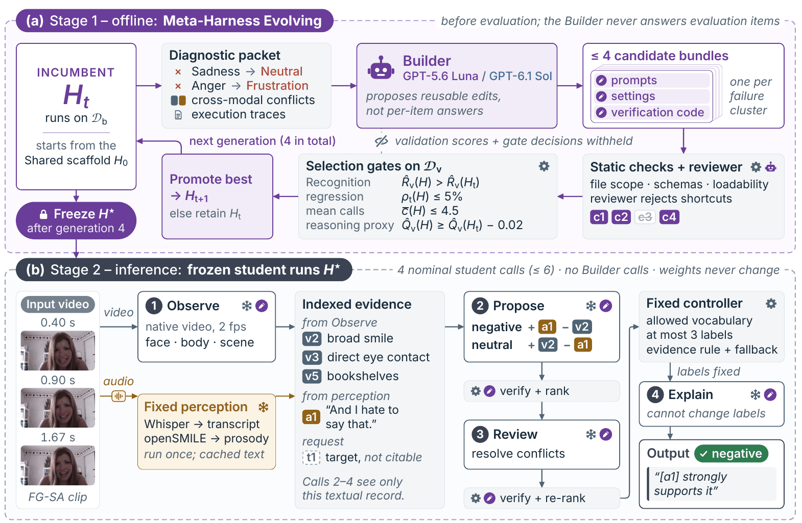

<h1 align="center">EmoHarness</h1>

<p align="center">
  <b>Boosting Multimodal Emotion Understanding with Meta-Harness Evolving</b>
</p>

<p align="center">
  <a href="https://arxiv.org/abs/2611.11994"></a>
  <a href="https://emo-harness.github.io"></a>
  <a href="https://www.python.org/downloads/"></a>
  <a href="LICENSE"></a>
  <a href="https://github.com/Emo-Harness/EmoHarness/pulls"></a>
  <a href="https://pre-commit.com/"></a>
</p>



Small multimodal models misjudge emotion when words, voice and visual cues
conflict. **EmoHarness** runs such a model, the frozen **student**, inside a
**harness**: the prompts, settings and verification code around its calls. The
human-written starting harness, the **Shared scaffold**, numbers the student's
visual observations, transcript and prosody descriptions as citable evidence and
has the student weigh candidate emotions against it in four calls (Observe,
Propose, Review, Explain). In **Meta-Harness Evolving (MHE)** a stronger LLM, the
**Builder**, reads the student's errors and execution traces offline and edits the
harness; static checks and validation gates decide which edits are kept, and the
Builder never sees evaluation items. The student's weights never change.

## Installation

```bash
# any Python >=3.10,<3.13 works; conda shown
conda create -n emoharness python=3.11 -y
conda activate emoharness

# install Poetry if you do not have it
curl -sSL https://install.python-poetry.org | python3 -
export PATH="$HOME/.local/bin:$PATH"

git clone https://github.com/Emo-Harness/EmoHarness.git
cd EmoHarness
poetry install --with api,audio      # puts the `emoharness` command on the PATH
```

| Group     | Command                          | When you need it                                                              |
| --------- | -------------------------------- | ----------------------------------------------------------------------------- |
| api       | `poetry install --with api`      | the Builder, the proposal reviewer and the reasoning-proxy judge (OpenAI SDK) |
| audio     | `poetry install --with audio`    | perception: Whisper large-v3 (faster-whisper) and openSMILE eGeMAPSv02        |
| dev, test | `poetry install --with dev,test` | the checks and the test suite                                                 |

The students are served with [vLLM](https://github.com/vllm-project/vllm) from
their own environments, which `emoharness serve` and the pipeline expect at
`~/.venvs/emoharness-vllm011` (vLLM 0.11.2, Qwen3-VL), `~/.venvs/emoharness-vllm019`
(vLLM 0.19.1, Qwen3.5) and `~/.venvs/emoharness-vllm019-tf513` (vLLM 0.19.1 with
transformers 5.13.1, Gemma 4). Perception needs `ffmpeg` on the `PATH` and a GPU.

## Setup

```bash
export OPENAI_API_KEY="your-openai-key"   # the Builder, reviewer and proxy judge (only `evolve` needs it)
```

Put the datasets under `data/raw/` (or point `MME_EMOTION_ROOT` at MME-Emotion):

```
data/raw/mme_emotion/                         MME-Emotion (github.com/QwenAudio/MME-Emotion)
data/raw/intentqa/test.csv                    IntentQA annotations (JoseponLee/IntentQA)
data/raw/intentqa/hf_mirror/IntentQA/videos/  IntentQA videos (hamedrahimi/IntentQA on Hugging Face)
data/raw/social_iq_video/{qa,video}/          Social-IQ 2.0 (PediaMedAI/Social-IQ-Video), optional
```

Each student is pinned to a Hugging Face revision (`experiments/common.py`);
download it into the Hugging Face cache before serving.

## Get started

### Check the wiring on fakes

The whole pipeline runs on fakes in under a minute, with no GPU, data, API key
or network:

```bash
emoharness reproduce --fake --root /tmp/emoharness-fake
```

### 1. Prepare the data

```bash
emoharness prepare
```

This builds the MME-Emotion manifest, carves the construction split out of the
seen task types and isolates it (399 build, 394 validation, 129 reserved items;
5,507 evaluation items), and fills the perception cache: 2 fps frames, the
Whisper transcript and openSMILE prosody.

### 2. Evaluate the four conditions

```bash
emoharness evaluate --student qwen3vl_4b
```

| Paper      | Row  | Student calls        | What the student sees                                   |
| ---------- | ---- | -------------------- | ------------------------------------------------------- |
| **Video**  | `L0` | 1                    | the native video                                        |
| **Audio**  | `L1` | 1                    | the video plus the transcript and prosody text          |
| **Shared** | `L3` | 4 (≤ 6 with retries) | the human-written scaffold in [`harness/`](harness/)    |
| **MHE**    | `L5` | about 4 (≤ 6)        | the student's evolved harness in [`bundles/`](bundles/) |

Each command starts the student's vLLM server and stops it afterwards, or reuses
one already started with `emoharness serve --student qwen3vl_4b`.

### 3. Evolve a harness with Meta-Harness Evolving

```bash
emoharness evolve --student qwen3vl_4b --builder sol
```

Four generations on the construction split; each generation the Builder proposes
up to four candidate harnesses, and a candidate replaces the incumbent only if it
passes the static checks, the proposal reviewer and the validation gates
(Recognition gain, ≤ 5 % regression, ≤ 4.5 mean calls, reasoning proxy within 2
points). The evolved harness is then evaluated like step 2. `--builder` takes
`luna` (GPT-5.6 Luna, whose harnesses are the frozen [`bundles/`](bundles/)), `sol`
(GPT-6.1 Sol) or `gpt6-luna` (GPT-6 Luna). The Luna and Sol harnesses are shipped
in [`bundles/`](bundles/); a rebuild makes paid API calls and, since the Builder
is not deterministic, yields a new harness with its own hash. A rebuilt Sol or
GPT-6 Luna harness replaces the shipped one in every later stage (IntentQA, the
report and the cases); the frozen Luna bundles stay what `evaluate` runs.

### 4. Emotion context on IntentQA

```bash
emoharness intentqa --student qwen3vl_4b --dataset intentqa_test
```

Each Builder's harness writes one emotion context per video without seeing any
question; the bare student then answers every question from the frames
(Frames), plus the transcript and prosody (Audio), plus the emotion context
(Audio + Emotion).

### 5. Report

```bash
emoharness report
```

Reads the finished runs and writes the tables, figure data and numbers to
`results/paper/`.

## Reproducing the paper

```bash
emoharness reproduce                 # every stage above for all four students and both Builders
emoharness reproduce --dry-run       # print every command, run nothing
```

Every stage skips the steps that already finished, so an interrupted run resumes.
`scripts/reproduce_paper.sh` is the same command.

## Package structure

```
src/emoharness/                 # the library
├── __main__.py                 # the `emoharness` command (dispatches into experiments/ and examples/)
├── data/                       # MME-Emotion tasks, prompt grammar, label sets, manifests, splits, isolation
├── perceive/                   # 2 fps frames, Whisper ASR, openSMILE prosody descriptors, the clip cache
├── harness/                    # the four-call runtime: evidence, verification, the fixed output controller
├── builder/                    # MHE: failure clusters, diagnostic packet, patches, reviewer, gates, loop
├── target/                     # vLLM (OpenAI-compatible) and Gemini clients, the call cache
├── baselines/                  # the single-call conditions (Video, Audio)
├── evaluation/                 # Recognition scoring, scoreboard, paired bootstrap, Holm, the proxy judge
├── runner/                     # paths, item sets, rows, construction, CLI plumbing
└── common/                     # I/O, hashing, logging, cost ledger, errors, constants

experiments/                    # the paper's experiments
├── layout.py                   # where every run writes; the Builders
├── common.py                   # the four students, their bundles, one owned vLLM server
├── paper/                      # pipeline (the stages), report, cases, export, serve
├── emotion_context/            # IntentQA: per-video emotion context, then the answering conditions
└── transfer/                   # IntentQA / Social-IQ 2.0 manifests

examples/                       # one entry script per single step
├── data/                       # prepare_benchmark, split_construction, isolate_construction, fit_prosody_reference, preprocess, leakage_report
├── mme/                        # run_ladder
└── mhe/                        # build_harness
scripts/                        # one shell twin per example (same layout, the paper's settings), plus
├── serve_student.sh            # one student on vLLM
└── reproduce_paper.sh          # every stage, in order

harness/                        # the Shared scaffold (prompts, YAML settings, schemas, verification code)
bundles/                        # the frozen MHE harnesses, hashes pinned in experiments/common.py
├── <student>/                  # GPT-5.6 Luna, one per student
└── gpt6_1_sol/<student>/       # GPT-6.1 Sol, one per student
configs/                        # builder/, target/, data/, experiments/ladder.yaml, preprocess.yaml
tests/                          # unit and integration tests, all on fakes
```

In the code the student is the _Target_, the proposal reviewer the _verifier_,
MHE a _Stage 3_ construction, and the four harness calls Observe, Propose, Review
and Explain are `harness/prompts/extract_visual.md`, `generate_hypotheses.md`,
`verify.md` and `synthesize.md`. Runs write `data/`, `results/` and `logs/`, none
of which git tracks.

<details>
<summary><b>All commands</b></summary>

`emoharness <command> --help` shows a command's own flags. Every paper command
takes `--student`, `--root`, `--fake`, `--dry-run` and `--force` where they apply.

| Command                                                                                                          | What it does                                                                                           |
| ---------------------------------------------------------------------------------------------------------------- | ------------------------------------------------------------------------------------------------------ |
| `reproduce`                                                                                                      | every stage below, in order; resumes where it stopped                                                  |
| `prepare`                                                                                                        | the data: manifest, construction split, isolation, prosody reference, perception cache, leakage report |
| `serve`                                                                                                          | serve one student with vLLM on port 8000                                                               |
| `evaluate`                                                                                                       | Video, Audio, Shared and the frozen MHE harness on MME-Emotion                                         |
| `evolve`                                                                                                         | one MHE construction per Builder (`--builder luna sol gpt6-luna`), then its harness on MME-Emotion     |
| `intentqa`                                                                                                       | each harness's emotion context on IntentQA (`--dataset`), then Frames / Audio / Audio + Emotion        |
| `report`                                                                                                         | the tables, figure data and numbers, under `results/paper/`                                            |
| `cases`                                                                                                          | the case studies (`--paper`), or one item's records under every condition                              |
| `export`                                                                                                         | a per-item data package of every run                                                                   |
| `prepare-benchmark`, `split-construction`, `isolate-construction`, `fit-prosody`, `preprocess`, `leakage-report` | the data steps one at a time (`examples/data/`)                                                        |
| `run-ladder`                                                                                                     | run ladder rows over an item set (`examples/mme/run_ladder.py`)                                        |
| `build-harness`                                                                                                  | run one construction stage (`examples/mhe/build_harness.py`)                                           |

</details>

## Contributing

See [CONTRIBUTING.md](CONTRIBUTING.md) for the conventions and run the same
checks as CI before opening a pull request:

```bash
poetry run ruff check src tests examples experiments
poetry run ruff format --check src tests examples experiments
poetry run mypy
poetry run pytest -m 'not integration'
poetry run pytest -m integration        # the whole pipeline on fakes
```

## Citation

If you use EmoHarness, please cite the
[paper](https://arxiv.org/abs/2611.11994):

```bibtex
@misc{li2026emoharness,
  title         = {EmoHarness: Boosting Multimodal Emotion Understanding with Meta-Harness Evolving},
  author        = {Li, Fenghai and Li, Bingxuan and Zhang, Jiawen and Shen, Yifan and Liu, Jiateng and Zhang, Yutong and Guo, Yue},
  year          = {2026},
  eprint        = {2611.11994},
  archivePrefix = {arXiv},
  primaryClass  = {cs.CL},
  url           = {https://arxiv.org/abs/2611.11994}
}
```

## License

MIT, see [LICENSE](LICENSE). MME-Emotion, IntentQA and the student models are
used under their own terms.
