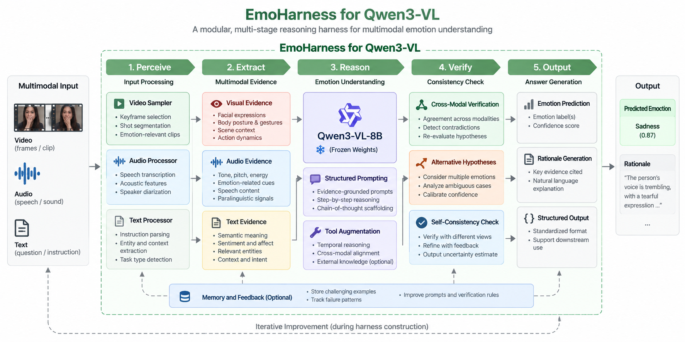

# EmoHarness research plan

> This is the original research plan and experiment specification, kept as the design record. For how to install and run the code see the [README](../README.md); for what was actually run and measured see [`experiments/README.md`](../experiments/README.md). Where this plan and an ADR in [`adr/`](adr/) disagree, the ADR wins.

> **Project status:** research proposal and experiment specification. Performance targets are proposed success criteria, not measured results.

> **Design decisions (2026-09-06, revised 2026-09-07 after a strict review).** This plan was stress-tested against the official MME-Emotion scripts and data and then reviewed as if it were the paper's method section (`review-2026-09-07.md`). Where a section below conflicts with an ADR in [`docs/adr/`](adr/), the ADR wins. The largest changes:
> - Harness construction data comes from **outside MME-Emotion**, so every main-claim score is on all 6,500 items and leaderboard-comparable ([ADR-0001](adr/0001-goal-and-evaluation-protocol.md), [ADR-0003](adr/0003-construction-corpus.md)). The 10/10/80 split in §5.2 is superseded.
> - Methods form a **ladder** L0–L6 so that adding an audio tool, output formatting, the multi-call scaffold, and the Builder's edits are measured separately; the central claim is the Builder gain L5 − L3 ([ADR-0009](adr/0009-experiment-scope-and-judge-allocation.md)).
> - Hypotheses are **pre-registered** with Recognition as the primary metric; the old "retain 80% of Gemini" criterion was already met by the plain baseline and is replaced by Gap Closed ([ADR-0012](adr/0012-preregistration-and-information-firewall.md), [ADR-0013](adr/0013-statistical-analysis-plan.md)).
> - The shipped `audio_clue/` files are judge-side evidence and are never read by the harness ([ADR-0004](adr/0004-audio-evidence-pipeline.md)).
> - The Builder optimizes local Recognition with a Reasoning non-regression gate through a controlled patch loop with staged permissions and replicates ([ADR-0005](adr/0005-builder-permissions-and-objective.md), [ADR-0006](adr/0006-builder-loop-mechanics.md), [ADR-0007](adr/0007-proxy-judge.md)).
> - The multi-label scoring weakness of the official judge is not exploited ([ADR-0010](adr/0010-output-controller-and-multilabel-policy.md)).
>
> Verified benchmark facts are in [`docs/benchmark-facts.md`](benchmark-facts.md), terms in [`docs/glossary.md`](glossary.md), the milestone plan in [`docs/plan.md`](plan.md), and the paper skeleton in [`docs/paper-outline.md`](paper-outline.md).

**EmoHarness** studies whether a stronger **Builder model** can construct a reusable inference-time harness for a smaller, frozen **Target model**. The current instantiation uses **GPT 5.6 Luna** as the Builder (an earlier run used Gemini 3.1 Pro) and **Qwen3-VL-8B** as the Target, with the goal of improving Qwen's multimodal emotion understanding without updating its weights.

<p align="center">
  
</p>

## 1. Research Question

Can a strong model discover reusable emotion-understanding procedures from a small set of **seen capabilities**, encode those procedures into an executable harness, and transfer them to **held-out capabilities** that were never available during harness construction?

The central hypothesis is:

> A Builder can transfer part of its capability to a smaller Target not by changing the Target's parameters, but by improving the system around it: input processing, evidence extraction, prompting, tool use, verification, memory, and output control.

### Main hypotheses

Pre-registered tests with Recognition score as the primary metric (ADR-0012):

- **H1 — Seen-task improvement:** Full EmoHarness (L5) beats Qwen Direct (L0) on the seen-task macro average, all items.
- **H2 — Cross-capability transfer:** L5 beats L0 on the held-out macro average, all items; per-task results are reported including negative ones.
- **H-B — Builder gain:** L5 beats the human-written Stage 1 scaffold (L3), which uses the same tools and inputs, on seen and on held-out tasks separately. This is the AI4AI claim.
- **H3 — Gap closed:** the fraction of the student-to-teacher Recognition gap closed by the harness reaches tier 1 (≥ 0.25) or tier 2 (≥ 0.5) on the pre-registered subset.
- **H4 — Generality (exploratory):** the frozen harness helps a second Target without modification.

## 2. Problem Formulation

Let:

- \(B\) be the Builder model, currently GPT 5.6 Luna;
- \(T\) be the frozen Target model, initially Qwen3-VL-8B;
- \(h\) be an inference-time harness;
- \(D_{build}\) and \(D_{val}\) contain examples from seen capabilities;
- \(D_{seen-test}\) contain hidden examples from those same capabilities;
- \(D_{held-out}\) contain capabilities never exposed during construction.

The Builder searches for a harness that improves validation performance while limiting regressions and inference cost:

\[
h^* = \arg\max_h
\left[
S(T, h; D_{val})
- \lambda C(h)
- \mu R(h)
\right],
\]

where \(S\) is task performance, \(C\) is inference cost, and \(R\) is regression on examples that the previous harness solved correctly.

After construction, \(h^*\) is frozen and evaluated without access to held-out labels, examples, capability names, or feedback.

## 3. What the Builder Actually Constructs

EmoHarness is not a single prompt. It is a versioned bundle of executable components specialized to the failure profile of Qwen3-VL-8B:

```text
harness/
├── manifest.json              # version, stage, parent hash, builder, notes
├── sampling.yaml              # face-crop and extra-image policy
├── routing.yaml               # stage order, verification functions, audio-opinion toggle
├── audio_pipeline.yaml        # evidence channels and transcript cap
├── evidence_schema.json       # generated from EvidenceRecord
├── output_schema.json         # generated from HarnessOutput
├── prompts/
│   ├── extract_visual.md
│   ├── generate_hypotheses.md
│   ├── verify.md
│   └── synthesize.md
└── verification/
    ├── cross_modal.py             # modalities_agree(record, hypotheses) -> bool
    └── alternative_hypotheses.py  # rank(record, hypotheses) -> list
```

The Target weights remain frozen. At Stage 2 the Builder may edit the prompts and the YAML files; at Stage 3 it may also edit the pure functions under `verification/`, which pass a static allowlist before they run. The output controller, schemas, and tools stay human-owned (ADR-0005).

## 4. Method

### 4.1 Harness construction loop

EmoHarness is constructed through a failure-driven iterative loop.

```text
1. Execute   Run Qwen3-VL-8B with the current harness on D_build.
2. Diagnose  Identify and cluster recurring failure patterns.
3. Propose   Generate minimal changes to prompts, tools, routing, or verification.
4. Validate  Evaluate each candidate on D_val and a regression set.
5. Promote   Accept only edits that improve validation performance within budget.
6. Freeze    Stop construction before any held-out capability is evaluated.
```

A simplified algorithm is:

```python
harness = initialize_harness()
regression_set = []

for round_id in range(max_rounds):
    build_outputs = run_target(target="Qwen3-VL-8B", harness=harness, data=D_build)
    failures = builder.diagnose(build_outputs, labels=D_build.labels)
    candidates = builder.propose_edits(harness, failures)

    best = select_with_regression_gate(
        candidates=candidates,
        validation_data=D_val,
        regression_data=regression_set,
        latency_budget=LATENCY_BUDGET,
        target_call_budget=TARGET_CALL_BUDGET,
    )

    if best is None:
        break

    harness = best
    regression_set = update_regression_set(regression_set, build_outputs)

freeze(harness)
```

### 4.2 Failure taxonomy

The Builder diagnoses failures at the level of reusable reasoning deficiencies rather than benchmark IDs.

| Failure family | Example | Candidate harness response |
|---|---|---|
| Modality neglect | Relies on transcript while ignoring facial expression | Force separate visual, audio, and text evidence extraction |
| Temporal context loss | Misses an emotion transition near the end of a clip | Add clip segmentation, salient-moment retrieval, and state tracking |
| Cross-modal conflict | Positive words but distressed voice and expression | Add contradiction detection and conflict-resolution rules |
| Coarse-to-fine confusion | Predicts "negative" instead of grief, fear, or frustration | Generate a coarse hypothesis before fine-grained alternatives |
| Multi-label overprediction | Returns many weakly supported emotions | Require evidence for each label and calibrate label-specific confidence |
| Unsupported intent inference | Infers hidden intent from one ambiguous cue | Require contextual support and compare alternative explanations |
| Format failure | Correct reasoning but invalid benchmark output | Add a deterministic output controller and schema validation |

### 4.3 Inference pipeline

At evaluation time, the frozen harness follows five stages.

#### Stage 1 — Perceive

- **Video sampler:** selects keyframes, segments shots, and retrieves emotionally salient moments.
- **Audio processor:** extracts speech transcripts, speaker turns, pitch, energy, pace, pauses, and other prosodic descriptors.
- **Text processor:** parses the question, candidate answers, relevant entities, and requested output type.

Because Qwen3-VL-8B is treated as the visual-language Target, raw audio is first converted into aligned text and acoustic descriptors by external tools. Video frames and the resulting audio summary are then provided to Qwen through the harness.

#### Stage 2 — Extract evidence

The harness builds a structured evidence record before asking for a final label.

```json
{
  "visual": {
    "face": ["tearful eyes", "downward gaze"],
    "body": ["closed posture"],
    "scene": ["conversation after receiving bad news"],
    "temporal_change": "neutral to distressed"
  },
  "audio": {
    "transcript": "I am fine.",
    "prosody": ["trembling voice", "long pause", "low energy"]
  },
  "text": {
    "task": "fine-grained emotion recognition",
    "question": "What emotion is the speaker experiencing?"
  }
}
```

#### Stage 3 — Reason

The frozen Target receives evidence-grounded prompts that ask it to:

1. identify the most likely coarse emotional state;
2. generate one or more fine-grained hypotheses;
3. cite supporting and contradicting evidence;
4. distinguish expressed emotion, underlying emotion, sentiment, and inferred intent;
5. avoid committing before the verification stage.

Tool augmentation may provide temporal alignment, retrieval of salient segments, schema checks, or deterministic score aggregation. Tools do not independently supply the gold label.

#### Stage 4 — Verify

The verification layer contains three complementary checks:

- **Cross-modal verification:** checks whether visual, audio, and textual evidence agree or conflict.
- **Alternative-hypothesis analysis:** compares plausible competing emotions and ambiguous interpretations.
- **Self-consistency check:** re-evaluates the answer from different evidence views and estimates uncertainty.

A prediction is promoted only when its supporting evidence is stronger than that of the alternatives. Otherwise, confidence is reduced or an ambiguity-preserving answer is returned when the benchmark permits it.

#### Stage 5 — Output

The output controller converts the internal result into the required benchmark format.

```json
{
  "emotion": ["sadness"],
  "confidence": 0.87,
  "supporting_evidence": [
    "tearful facial expression",
    "trembling voice",
    "negative emotional transition near the end of the clip"
  ],
  "alternative_hypotheses": [
    {"label": "anxiety", "confidence": 0.28}
  ],
  "rationale": "The verbal statement is positive, but the synchronized facial and vocal cues consistently indicate sadness."
}
```

For MME-Emotion the controller emits a fixed five-step rationale followed by `<answer>label</answer>`, because the official judge scores extracted steps as well as the final label (ADR-0010).

### 4.4 Memory and feedback

Construction-time memory stores:

- recurring Target failure patterns;
- edits that improved or harmed validation performance;
- difficult examples used for regression testing;
- prompt and verifier versions;
- cost and latency statistics.

This memory is used only to construct the harness. It is frozen before final testing, and held-out examples are never added to it. Per-sample scratch memory is cleared between evaluation instances unless a benchmark explicitly defines a conversational sequence.

## 5. Data

### 5.1 Planned benchmark capabilities

The protocol uses the eight emotion task families of MME-Emotion.

| Group | Capability | Description | Construction access |
|---|---|---|---|
| Seen | **ER-Lab** | Emotion recognition in controlled or laboratory settings | Same *kind* of data from external sources; benchmark items never used |
| Seen | **ER-Wild** | Emotion recognition in natural, unconstrained settings | Same *kind* of data from external sources; benchmark items never used |
| Seen | **SA** | Sentiment analysis | Same *kind* of data from external sources; benchmark items never used |
| Held out | **Noise-ER** | Emotion recognition under noise or distracting signals | None |
| Held out | **FG-ER** | Fine-grained emotion recognition | None |
| Held out | **ML-ER** | Multi-label emotion recognition | None |
| Held out | **FG-SA** | Fine-grained sentiment analysis | None |
| Held out | **IR** | Higher-level emotion, intention, or implicit-state reasoning | None |

The benchmark source is **MME-Emotion** (6,500 items, HF dataset `Karl28/MME-Emotion`, official scripts in `QwenAudio/MME-Emotion`). The repository records the exact dataset revision and checksums at download time.

### 5.2 Split protocol

Superseded by ADR-0001 and ADR-0003. In short: construction (450), validation (450), and external test (300) examples come from MELD, CMU-MOSEI, CH-SIMS, and IEMOCAP or CREMA-D train portions, restricted to the three seen capability kinds and deduplicated against all eight benchmark tasks by media hash, perceptual hash, transcript similarity, and source id. All 6,500 benchmark items are test items. What "held-out" excludes and cannot exclude is stated in ADR-0001.

For held-out capabilities:

- **0%** may be used for harness construction;
- **0%** may be used for prompt selection, threshold tuning, or early stopping;
- labels remain available only to the final evaluator;
- capability names are not passed to the harness at inference time.

### 5.3 Canonical data manifest

Each example is represented through a normalized manifest:

```json
{
  "example_id": "mme_emotion_000001",
  "source_id": "original_video_or_conversation_id",
  "capability": "ER-Wild",
  "split": "build",
  "video_path": "data/raw/video/000001.mp4",
  "audio_path": "data/derived/audio/000001.wav",
  "question": "What emotion is expressed?",
  "choices": ["joy", "sadness", "anger", "fear"],
  "label": "sadness",
  "multi_labels": null,
  "metadata": {
    "duration_seconds": 12.4,
    "language": "en",
    "speaker_count": 1
  }
}
```

Fields unavailable in the source benchmark remain `null`; they must not be fabricated. Transcripts, sampled frames, acoustic descriptors, and evidence summaries are stored as **derived artifacts**, not as additional ground-truth annotations.

### 5.4 Leakage controls

- Split by `source_id`, not individual question, to avoid near-duplicate clips across partitions.
- Keep all questions derived from the same source in the same split.
- Deduplicate by media hash and perceptual similarity, including construction media against benchmark media.
- Do not reveal the capability label to the harness.
- Do not inspect held-out labels during error analysis.
- Never read the benchmark's `audio_clue/` files from any harness, Target, or Builder code path.
- Lock the harness commit hash before held-out evaluation.
- Record every Builder and Target call for auditability.
- Separate construction logs from final evaluation logs.

### 5.5 Data quality checks

Before experiments, the data pipeline should verify:

- media files load correctly;
- audio and video are synchronized;
- question, answer space, and label are valid;
- multi-label examples use a canonical ordering;
- class distributions are reported by capability and split;
- source overlap and exact duplicates are zero across splits;
- all preprocessing artifacts can be regenerated from raw data.

## 6. Experiment Plan

### 6.1 Models

| Role | Primary model | Weight updates | Purpose |
|---|---|---:|---|
| Builder | GPT 5.6 Luna (ADR-0015) | No | Diagnose failures and construct the harness |
| Target | Qwen3-VL-8B-Instruct | **Frozen** | Execute emotion-understanding tasks with or without the harness |
| Upper bound | GPT 5.6 Luna direct, matched protocol | No | Estimate Builder-level task performance |
| Transfer targets | Qwen3-VL-4B-Instruct (P1); InternVL3.5-8B (P2) | Frozen | Exploratory cross-Target points |

All systems should receive the same media content. If a model lacks native audio support, it receives the same transcript and acoustic descriptors produced by the shared preprocessing pipeline. The teacher row runs the matched protocol because the OpenAI API accepts frames, not video (ADR-0015).

### 6.2 The ladder of methods

Each rung adds one ingredient to the rung below; adjacent differences isolate one effect (ADR-0009). Rungs L1 and above read the same shared cache and see identical frames and audio text.

| Rung | Method | Target calls | Isolates |
|---|---|---:|---|
| L0 | Qwen Direct: official prompt, native video, one call | 1 | baseline |
| L1 | Qwen Direct + audio text | 1 | modality augmentation |
| L2 | Handcrafted five-step prompt with a human cue checklist | 1 | prompt and format engineering |
| L3 | Human-Designed Harness: the Stage 1 scaffold | 4 | multi-call scaffold with tools |
| L4 | Builder Prompt-Only: the Stage 2 harness | ≤ 6 | Builder edits to prompts and configs |
| L5 | **Full EmoHarness**: the Stage 3 harness | ≤ 6 | Builder edits to verification code |
| L6 | GPT 5.6 Luna Direct, frames + audio text | 1 | upper bound |

Test-time scaling controls with the same call count as L3: Best-of-4 over L2 (P0) and sequential refinement over L2 (P2). Which rows run on all 6,500 items and which on the pre-registered 1,000-item subset is fixed in ADR-0009.

### 6.3 Main experiments

| ID | Research question | Rows | Items | Primary outcome |
|---|---|---|---|---|
| E1 | Does the harness improve the Target on seen capabilities? | L0 vs. L5 | full seen | H1 |
| E2 | Does improvement transfer to unseen capabilities? | L0 vs. L5 | full held-out | H2 |
| E-B | Does the Builder add value beyond the human scaffold? | L3 vs. L5 | full | H-B |
| E3 | Is the gain more than test-time scaling? | L2, Best-of-4, L3, L5 | subset | equal-call comparison |
| E4 | How much of the gap to the teacher is closed? | L0, L5, L6 | subset | H3 |
| E5 | Which modules cause the gain? | L5 vs. five ablations | subset | score drop per module |
| E6 | Does the harness help a second Target? | Qwen3-VL-4B ± L5 (InternVL3.5-8B if P2) | subset | H4, exploratory |
| E7 (P2) | How much construction data is needed? | 25%, 50%, 100% of D_build | subset | data-efficiency curve |
| E8 (P2) | How does Builder strength matter? | the earlier Gemini 3.1 Pro run vs. GPT 5.6 Luna | subset | Builder-scaling curve |

### 6.4 Metrics

#### Task performance

Recognition score is the primary metric for every hypothesis. Reasoning, CoT, and Avg Step are reported for leaderboard comparability; precision, recall, and F1 are added for the multi-label tasks.

- Seen average score
- Held-out average score
- Overall macro average
- Per-capability improvement over Qwen Direct
- Worst-capability score and regression

#### Transfer metrics

\[
\Delta_{seen} = S_{seen}(T+h) - S_{seen}(T)
\]

\[
\Delta_{held-out} = S_{held-out}(T+h) - S_{held-out}(T)
\]

\[
\text{Transfer Ratio} =
\frac{\Delta_{held-out}}{\Delta_{seen}}
\]

The numerator and denominator must always be reported alongside the ratio because the ratio is unstable when the seen gain is near zero.

#### Builder capability transfer

\[
\text{Gap Closed} =
\frac{S(\text{L5})-S(\text{L0})}
{S(\text{L6})-S(\text{L0})},
\qquad
\text{Builder Gain} = S(\text{L5}) - S(\text{L3}),
\]

with \(S\) the Recognition score. Gap Closed has pre-registered tiers of 0.25 and 0.5. Gemini Performance Retained, \(S(\text{L5}) / S(\text{L6})\), is reported as a descriptive number next to the baseline's own value \(S(\text{L0}) / S(\text{L6})\).

#### Reliability and efficiency

- Failure recovery rate
- Regression rate
- Average Target calls per example
- Input and output tokens
- End-to-end latency
- Peak memory
- Construction-time Builder calls and cost
- Final inference cost per example

### 6.5 Statistical protocol

See ADR-0013. Paired bootstrap over items with 10,000 resamples within task; 95% intervals; detectable effects of about 2.5 points on full seen, 3 on full held-out, 5 on the subset overall, and 14 per task on the subset, so per-task subset numbers are descriptive. The official judge's test-retest noise floor is measured and differences below it are not interpreted. The four pre-registered tests also receive Holm-adjusted p-values. Greedy decoding for the Target; Gemini at temperature 0 with response ids logged.

### 6.6 Ablations

Five ablations of L5 on the pre-registered subset: no audio evidence; no modality-separated evidence extraction; no cross-modal verification; no alternative-hypothesis generation; no deterministic output controller. One further check at P2: no audio-model opinion channel. Construction variability is measured with three Stage 2 replicates.

## 7. Reproducibility Checklist

A released run should include:

- dataset version and license;
- source and split checksums;
- exact Builder and Target model versions;
- complete harness artifact and commit hash;
- prompts, routing rules, tools, and thresholds;
- Builder construction transcript or an auditable summary;
- decoding parameters and random seeds;
- target-call, token, latency, and cost budgets;
- raw predictions before post-processing;
- official per-capability metrics;
- bootstrap scripts and confidence intervals;
- a declaration that held-out capabilities were not accessed during construction.

## 8. Limitations and Responsible Use

Emotion labels can be ambiguous, culturally dependent, context-sensitive, and affected by annotation choices. EmoHarness outputs should not be treated as direct measurements of a person's internal state, medical condition, honesty, or intent.

The project should therefore:

- report uncertainty and alternative hypotheses;
- avoid unsupported psychological or clinical conclusions;
- audit performance across languages, cultures, demographics, and recording conditions when metadata permits;
- respect media privacy and dataset consent requirements;
- analyze whether rationales faithfully reflect evidence rather than merely sounding plausible;
- document cases where modality conflicts make a single label inappropriate.

## 9. Milestones

See [`docs/plan.md`](plan.md) for the ordered milestones, acceptance criteria, external action items, and risks.

## 10. One-Sentence Summary

**GPT 5.6 Luna builds a modular, failure-driven EmoHarness that helps frozen Qwen3-VL-8B perceive, extract, reason, verify, and answer multimodal emotion questions, with the central test being whether the Builder's edits add Recognition accuracy beyond a human-written scaffold with the same tools, on capabilities the Builder never saw.**
